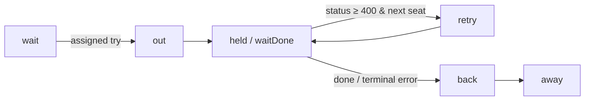

<div align="center">

<picture>
  <source media="(prefers-color-scheme: dark)" srcset="assets/logo-dark.svg">
  <source media="(prefers-color-scheme: light)" srcset="assets/logo-light.svg">
  
</picture>

# herdr-magpie

**Watch your LLM requests fly: live routing topology, quota monitor & request inspector for [Herdr](https://herdr.dev).**

[](https://github.com/dorokuma/herdr-magpie/releases)
[](https://herdr.dev)
[](https://gpui-kit.com)
[](LICENSE)

[Quick Start](#quick-start) · [Highlights](#highlights) · [Offline Demo](#offline-demo) · [State Machine](#how-the-flight-state-machine-works)

English · [简体中文](README.zh-CN.md)

</div>

---

<div align="center">
  
</div>

## Highlights

| | |
| --- | --- |
| **Adaptive Topology & Flow Themes**<br>Adaptive stage card height, client icons on agent pills, active-route spotlighting, and 3 switchable flow themes (`Minimal` default, `Stream`, `Magpie`). | **Multi-Account Quotas**<br>87 bundled brand icons, green/gold/red remaining-% bars, folded `71% · 96%` short·long readings (or one icon-led pair per model family), every account listed and drag-to-reorder kept. |
| **Cache Hit & Smart `tok/s`**<br>One `Requests` header counts `active · recent`, `· 99% cached` prompt-cache rate, post-completion `tok/s` excluding TTFT (falling back to end-to-end on short tails), per-try HTTP status cards. | **Interactive Focus & Privacy**<br>Hover to spotlight connections, click to lock and filter the request feed, one-click `Masked` / `Shown` account privacy. |
| **Space-Aware Herdr Layout**<br>First-class `Magpie` layout card in Settings → Look; `tabs-routing` remembers the sidebar per Space and fits the desktop titlebar. | **Zero-Dep & Self-Updating**<br>Pure ESM, no `node_modules`; in-panel one-click update with `sha256` verify; zero-network offline Demo mode. |

## Switchable Flow Themes

Hover over the routing stage card to reveal the bottom-right theme pill and switch animation styles live (saved in `localStorage`, or set `"stageStyle"` in `~/.config/herdr-app/mods/routing/config.json`):

- **`Minimal` *(default)***: Clean breathing S-curves with zero extra frame-loop overhead.
- **`Stream`**: Glowing optical-fiber beam gliding along active routes.
- **`Magpie`**: Animated miniature magpies carrying packets along the curve.

## Quick Start

You need [Herdr](https://herdr.dev) and a Magpie gateway on `127.0.0.1:3425` — or point the mod at a remote host through `herdr-core`, or just open the offline Demo below.

### 1. Install

```bash
V=$(curl -fsSLI -o /dev/null -w '%{url_effective}' https://github.com/dorokuma/herdr-magpie/releases/latest | sed 's|.*/v||')
curl -fsSL "https://github.com/dorokuma/herdr-magpie/releases/download/v$V/herdr-magpie-$V.tar.gz" | tar xz -C /tmp && "/tmp/herdr-magpie-$V/install.sh"
```

Prefer a clone instead? See [What's Included & Local Development](#whats-included--local-development).

### 2. Switch to the `Magpie` Layout

Press `Ctrl+Shift+L` inside Herdr (or open **Settings → Look → Layout** and click **Magpie**), then click the **Routing** button in the top-right tab bar.

<a name="offline-demo"></a>

> [!TIP]
> **Offline Demo Mode** — set `{"demo": true}` in `~/.config/herdr-app/mods/routing/config.json` to render the complete stage with zero network and zero credentials.

## How the Flight State Machine Works



- **`wait` → `out`**: Magpie assigns the request to an upstream account (`r.tries[i]`); an outbound pulse glides along the S-curve to the target seat.
- **`held` / `waitDone`**: the wire breathes with GPUI's `.loop("opacity")` while upstream generates (`tr.done`).
- **`retry`**: a `status >= 400` attempt with a next seat shakes the failed pill, flashes `#e26a6a`, and dives back to the next seat, where it is `held` again.
- **`back` → `away`**: `r.done` or a terminal error sends the return pulse home; once it lands, the wire fades out.

## More Details

<details>
<summary><b>Updating &amp; Auto-Check Schedule</b></summary>

The panel updates itself. When a newer release is published, an
**`↑ Update x.y.z`** pill appears in the panel's top bar, right after the `Magpie` title.
Click it: the release archive is downloaded from GitHub, its `sha256` is
verified, the files are laid over the install and Herdr reloads the panel. Your
`mods/routing/config.json` (gateway, remote, demo) is kept, and so are your fold
state and row order. While you are on the newest release the pill is not there.

The mod looks for a release:

- when the panel starts, if its last look is more than 6 hours old (a known
  update shows at once from the kept answer, without asking again);
- every 6 hours while it runs, by the wall clock, so a laptop that slept is
  checked as it wakes;
- when you press **Refresh** on Agent Quota, at most once in 10 minutes;
- again after a look that failed: after 2, 10 and 30 minutes, then hourly, and
  as soon as the gateway is reachable again.

A look is one `HEAD` request to `github.com/dorokuma/herdr-magpie/releases/latest`
from your own machine. Nothing is sent, no token is used, and demo mode never
looks.

Older installs without the update pill can run the two install lines above once.

</details>

<details>
<summary><b>Remote Magpie Host Configuration</b></summary>

By default, `herdr-magpie` connects to `http://127.0.0.1:3425` on your local machine and reads `~/.config/magpie/providers.json` to discover your installed providers.

If your Magpie gateway runs on a remote Herdr machine (via `herdr-core`), copy `config.example.json` to `config.json`:

```bash
cp ~/.config/herdr-app/mods/routing/config.example.json \
   ~/.config/herdr-app/mods/routing/config.json
```

Edit `~/.config/herdr-app/mods/routing/config.json`:

```json
{
  "remote": "my-remote-machine",
  "label": "my-remote-machine · 127.0.0.1:3425",
  "baseUrl": "http://127.0.0.1:3425",
  "demo": false
}
```

</details>

<a id="whats-included--local-development"></a>

<details>
<summary><b>What's Included &amp; Local Development</b></summary>

```text
herdr-magpie/
├── assets/
│   ├── logo-dark.svg               # Logo for GitHub dark mode
│   └── logo-light.svg              # Logo for GitHub light mode
├── layouts/
│   ├── Magpie.json                 # Herdr workspace layout integrating the Routing side panel
│   ├── Magpie.svg                  # Vector layout preview thumbnail
│   └── Magpie.png                  # Raster layout preview thumbnail for Settings -> Look
├── mods/
│   ├── routing/
│   │   ├── main.js                 # Live topology stage, quota monitor, and request inspector
│   │   ├── route.svg               # Routing node-split icon
│   │   ├── config.example.json     # Optional local/remote Magpie gateway configuration
│   │   ├── demo.json               # Synthetic fixture for offline previews and screenshots
│   │   └── icons/                  # 87 bundled agent & provider icons (SVG + 64x64 PNG)
│   └── tabs-routing/
│       └── main.js                 # Tab bar with per-space Routing / Files / Changes toggles
├── tests/                          # node --test tests/*.test.mjs (see tests/README.md)
├── scripts/release-check.sh        # Release gate
├── RECIPE.md                       # Herdr layout & mod build specification
└── install.sh                      # One-step installer & verifier
```

Clone and run `./install.sh` (copies `layouts/` and `mods/` into `~/.config/herdr-app` and validates both mods with `herdr-app check`):

```bash
git clone https://github.com/dorokuma/herdr-magpie.git
cd herdr-magpie
chmod +x install.sh
./install.sh
```

Run the offline test suite with `node --test tests/*.test.mjs` (see `tests/README.md`), and read `RECIPE.md` for the Herdr layout & mod build specification.

</details>

## License

Released under the [MIT License](LICENSE).
