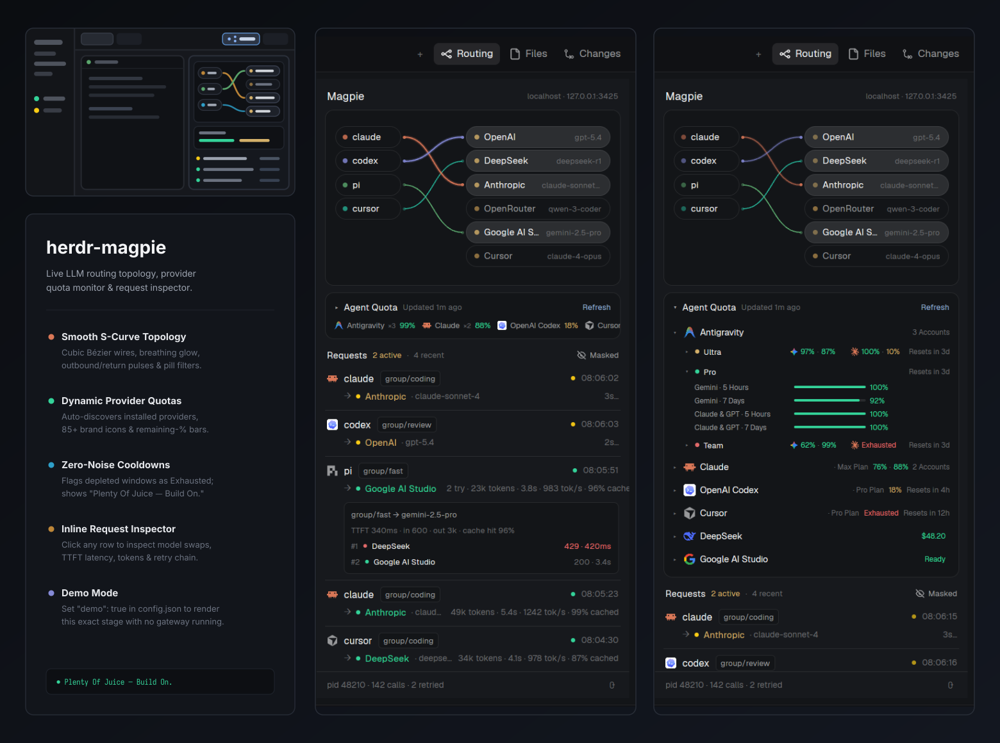

<div align="center">


# herdr-magpie

**Live LLM routing topology, provider quota monitor, and request inspector for [Herdr](https://herdr.dev).**

[](https://github.com/dorokuma/herdr-magpie/releases)
[](https://herdr.dev)
[](https://gpui-kit.com)
[](LICENSE)

English · [简体中文](README.zh-CN.md)

</div>

---

<div align="center">
  
</div>

## Highlights

- **Smooth S-Curve Topology** — Native GPUI cubic Bézier wires (`PathBuilder.cubic_bezier_to`) with `4px` port breathing gaps, anchor dots, native `.loop()` glow animations, real-time outbound/return pulses, and red error-shake flashes.
- **Interactive Node Filtering** — Hover any agent or provider pill to spotlight its active and recent connections; click a pill to lock focus and filter the `REQUESTS` feed below.
- **Dynamic Provider Quotas** — Automatically discovers your installed Magpie providers and brand icons (85+ bundled vector/raster logos). Displays unified **remaining-%** bars in Title Case (`Extra Credits`, `Free Plan`, `5 Hours`), flags depleted windows as `Exhausted`, hides noisy static config text rows, and shows `● Plenty Of Juice — Build On.` when a plugin provider has zero active cooldowns.
- **Inline Request Inspector** — Clean `IN FLIGHT` and `RECENT` feeds with one-click `Masked` / `Shown` account privacy toggle. Click any request row to expand an inline trace card showing model swaps, TTFT latency, input/output tokens, and per-try HTTP statuses.
- **First-Class Herdr Layout Card** — Ships as the **Magpie** layout (`layouts/Magpie.json`) with a custom vector/raster preview card (`layouts/Magpie.svg` & `layouts/Magpie.png`) in **Settings → Look**.
- **Reproducible Demo Mode** — Built-in, fully synthetic fixture renders the complete stage without a gateway, credentials, or live provider data. Ideal for screenshots, reviews, and trying the mod before setup.

## What's Included

```text
herdr-magpie/
├── layouts/
│   ├── Magpie.json                 # Herdr workspace layout integrating the Routing side panel
│   ├── Magpie.svg                  # Vector layout preview thumbnail
│   └── Magpie.png                  # Raster layout preview thumbnail for Settings -> Look
├── mods/
│   ├── routing/
│   │   ├── main.js                 # Live topology stage, quota monitor, and request inspector
│   │   ├── route.svg               # Routing node-split icon
│   │   ├── config.example.json     # Optional local/remote Magpie gateway configuration
│   │   ├── demo.json               # Synthetic fixture for offline previews and screenshots
│   │   └── icons/                  # 85+ bundled agent & provider icons (SVG + 64x64 PNG)
│   └── tabs-routing/
│       └── main.js                 # Tab bar with per-space Routing / Files / Changes toggles
├── RECIPE.md                       # Herdr layout & mod build specification
└── install.sh                      # One-step installer & verifier
```

## Quick Start

### 1. Install

Clone the repository and run `./install.sh` (copies `layouts/` and `mods/` into `~/.config/herdr-app` and validates both mods with `herdr-app check`):

```bash
git clone https://github.com/dorokuma/herdr-magpie.git
cd herdr-magpie
chmod +x install.sh
./install.sh
```

### 2. Switch to the `Magpie` Layout

Press `Ctrl+Shift+L` inside Herdr (or open **Settings → Look → Layout** and click **Magpie**), then click the **Routing** button in the top-right tab bar.

### 3. Optional: Remote Magpie Host Configuration

By default, `herdr-magpie` connects to `http://127.0.0.1:3425` on your local machine and reads `~/.config/magpie/providers.json` to discover your installed providers.

If your Magpie gateway runs on a remote Herdr machine (via `herdr-core`), copy `config.example.json` to `config.json`:

```bash
cp ~/.config/herdr-app/mods/routing/config.example.json \
   ~/.config/herdr-app/mods/routing/config.json
```

Edit `~/.config/herdr-app/mods/routing/config.json`:

```json
{
  "remote": "my-remote-machine",
  "label": "my-remote-machine · 127.0.0.1:3425",
  "baseUrl": "http://127.0.0.1:3425",
  "demo": false
}
```

### 4. Optional: Offline Demo Mode

Set `"demo": true` in `~/.config/herdr-app/mods/routing/config.json` to render the built-in synthetic fixture instead of polling a gateway:

```json
{
  "demo": true
}
```

The fixture lives at `~/.config/herdr-app/mods/routing/demo.json` and contains only invented agents, providers, requests, and quota values. Demo mode makes no network requests and does not read your real Magpie providers. Set `"demo": false` to return to live mode.

## How the Flight State Machine Works

Each route from `/v1/magpie/trace` drives a lightweight state machine synchronized with real gateway events:

1. **`wait` → `out`**: Triggered as soon as Magpie assigns a request to an upstream account (`r.tries[i]`). An outbound pulse glides along the S-curve to the target seat.
2. **`held` / `waitDone`**: The wire breathes gently using GPUI's native `.loop("opacity")` while waiting for upstream generation (`tr.done`).
3. **`retry`**: If an upstream attempt fails (`status >= 400`) and Magpie reroutes to the next candidate, the failed pill shakes, flashes `#e26a6a`, and arcs to the next seat.
4. **`back` → `away`**: Once `r.done` completes, the return pulse glides back to the originating agent and the wire fades out.

## License

Released under the [MIT License](LICENSE).
