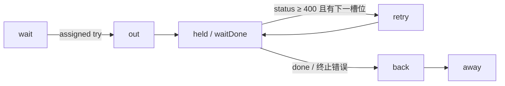

<div align="center">

<picture>
  <source media="(prefers-color-scheme: dark)" srcset="assets/logo-dark.svg">
  <source media="(prefers-color-scheme: light)" srcset="assets/logo-light.svg">
  
</picture>

# herdr-magpie

**看得见每一次 LLM 路由：[Herdr](https://herdr.dev) 的实时路由拓扑、配额监控与请求追踪面板。**

[](https://github.com/dorokuma/herdr-magpie/releases)
[](https://herdr.dev)
[](https://gpui-kit.com)
[](LICENSE)

[快速开始](#快速开始) · [核心特性](#核心特性) · [离线演示](#离线演示) · [状态机](#路由脉冲状态机)

[English](README.md) · 简体中文

</div>

---

<div align="center">
  
</div>

## 核心特性

| | |
| --- | --- |
| **自适应拓扑与可切换动效**<br>随行数自适应高度、左侧客户端图标、活跃路由聚光高亮，以及三套可切换连线动效（`Minimal` 默认 / `Stream` / `Magpie`）。 | **多账号配额监控**<br>内置 87 个品牌图标、绿/金/红剩余百分比条，折叠时 `71% · 96%` 短·长窗口读数（多模型系订阅按系别图标分列展示）；多账号全量列举，拖拽重排自动持久化。 |
| **缓存命中与智能 `tok/s`**<br>单行 `Requests` 计数头（`active · recent`）、`· 99% cached` 提示词缓存命中率、完成后按生成时长估算 `tok/s`（短尾自动回退端到端速率）、逐次尝试 HTTP 状态展开卡。 | **交互聚焦与隐私保护**<br>悬停聚光连线、点击锁定并过滤请求流、一键 `Masked` / `Shown` 账号脱敏。 |
| **感知 Space 的 Herdr 布局**<br>一等公民 `Magpie` 布局卡（Settings → Look）；`tabs-routing` 按 Space 记忆侧栏状态并适配桌面端标题栏。 | **零依赖与自更新**<br>纯 ESM、零 `node_modules`；面板内 `sha256` 校验一键更新；零网络离线演示模式。 |

## 动效主题切换

鼠标悬停在顶部路由卡片上时，右下角会浮出主题切换按钮，可实时切换三套连线动效（自动记忆到 `localStorage`，也可在 `~/.config/herdr-app/mods/routing/config.json` 中通过 `"stageStyle"` 指定）：

- **`Minimal`（默认）**：极简呼吸连线，无额外帧循环开销。
- **`Stream`**：光纤流光束沿活跃连线往返滑动。
- **`Magpie`**：飞鸟动效，小喜鹊衔着数据包沿曲线往返飞行。

## 快速开始

需要 [Herdr](https://herdr.dev) 与本机 `127.0.0.1:3425` 上的 Magpie 网关——也可以经 `herdr-core` 连接远端主机，或直接打开下方的离线演示。

### 1. 安装

**macOS / Linux** —— 在终端中粘贴：

```bash
(
  set -e
  V=$(curl -fsSLI -o /dev/null -w '%{url_effective}' https://github.com/dorokuma/herdr-magpie/releases/latest | sed 's|.*/v||')
  T=$(mktemp -d)
  trap 'rm -rf "$T"' EXIT
  curl -fsSL "https://github.com/dorokuma/herdr-magpie/releases/download/v$V/herdr-magpie-$V.tar.gz" | tar xz -C "$T"
  "$T/herdr-magpie-$V/install.sh"
)
```

**Windows** —— 在 PowerShell 中粘贴（Windows 原生 PowerShell，不是 WSL）：

```powershell
& {
  $ErrorActionPreference = 'Stop'
  $Curl = "$env:SystemRoot\System32\curl.exe"
  $Tar = "$env:SystemRoot\System32\tar.exe"
  $Url = & $Curl -fsSLI -o NUL -w '%{url_effective}' https://github.com/dorokuma/herdr-magpie/releases/latest
  if ($LASTEXITCODE -ne 0) { throw "curl failed (exit $LASTEXITCODE)" }
  $V = ([string]$Url) -replace '.*/v', ''
  if ([string]::IsNullOrWhiteSpace($V)) { throw 'could not resolve the latest release version' }
  $T = Join-Path $env:TEMP ("herdr-magpie-" + [Guid]::NewGuid().ToString('N'))
  New-Item -ItemType Directory -Force -Path $T | Out-Null
  try {
    & $Curl -fsSL "https://github.com/dorokuma/herdr-magpie/releases/download/v$V/herdr-magpie-$V.tar.gz" -o "$T\pkg.tgz"
    if ($LASTEXITCODE -ne 0) { throw "curl failed (exit $LASTEXITCODE)" }
    & $Tar xzf "$T\pkg.tgz" -C $T
    if ($LASTEXITCODE -ne 0) { throw "tar failed (exit $LASTEXITCODE)" }
    & "$T\herdr-magpie-$V\install.ps1"
  } finally {
    Remove-Item -Recurse -Force -ErrorAction SilentlyContinue -LiteralPath $T
  }
}
```

若本机 PowerShell 执行策略为 `Restricted`，需先允许执行本地脚本，例如 `Set-ExecutionPolicy -Scope Process RemoteSigned`。

想用 clone 方式安装？见[目录结构与本地开发](#目录结构与本地开发)。

安装脚本按 `herdr-app` 自身的规则解析配置目录：优先 `$HERDR_APP_HOME`，其次 `$XDG_CONFIG_HOME/herdr-app`，否则 Linux 与 macOS 为 `~/.config/herdr-app`、Windows 为 `%USERPROFILE%\.config\herdr-app`。如果你的 Herdr 运行在 Windows 宿主机上，请在 Windows 原生 PowerShell 中运行安装脚本——在 WSL 中运行 `install.sh` 只会安装给同样运行在 WSL 内的 Herdr。

### 2. 切换到 `Magpie` 布局

在 Herdr 中按 `Ctrl+Shift+L`（或打开 **Settings → Look → Layout** 点击 **Magpie**），再点击右上角标签栏的 **Routing** 按钮。

<a name="离线演示"></a>

> [!TIP]
> **离线演示模式** — 在 `~/.config/herdr-app/mods/routing/config.json` 中写入 `{"demo": true}`，即可零网络、零凭据预览完整舞台。

## 路由脉冲状态机



- **`wait` → `out`**：Magpie 将请求分配给某个上游账号（`r.tries[i]`），去程脉冲沿 S 型曲线滑向目标槽位。
- **`held` / `waitDone`**：等待上游生成（`tr.done`）期间，连线以 GPUI `.loop("opacity")` 缓缓呼吸。
- **`retry`**：某次尝试 `status >= 400` 且存在下一槽位时，失败的胶囊抖动、红闪 `#e26a6a`，弧线折返至下一槽位并再次进入 `held`。
- **`back` → `away`**：`r.done` 或终止错误触发返程脉冲滑回发起方，抵达后连线淡出。

## 更多配置与详情

<details>
<summary><b>自动检查与面板内一键更新</b></summary>

面板支持自更新。有新版本发布时，面板顶栏 `Magpie` 标题后面会出现
**`↑ Update x.y.z`** 按钮；点一下，它会从 GitHub 下载发布包、校验 `sha256`、把文件铺到
安装目录，Herdr 随即自动重载面板。你的 `mods/routing/config.json`（网关、远端、演示模式）
以及折叠状态、排序都会保留。已经是最新版本时，这个按钮不会出现。

检查新版本的时机：

- 面板启动时，仅当距上次检查超过 6 小时（已知的更新会直接从缓存结果显示，不重复请求）；
- 运行期间每 6 小时一次，按系统时钟计算，所以笔记本休眠唤醒后会立刻补查；
- 点击 Agent Quota 的 **Refresh** 时，最多每 10 分钟一次；
- 检查失败后依次在 2、10、30 分钟后重试，之后每小时一次；网关恢复可达时也会立刻重试。

一次检查只是从本机向 `github.com/dorokuma/herdr-magpie/releases/latest` 发一个 `HEAD`
请求，不上传任何数据、不需要 token；演示模式下从不检查。

未带该按钮的旧版安装，按上面的两行安装命令手动更新一次即可。

</details>

<details>
<summary><b>远端 Magpie 网关配置</b></summary>

默认连接本机 `http://127.0.0.1:3425`，并读取 `~/.config/magpie/providers.json` 来发现已安装的供应商。

如果你的 Magpie 运行在通过 `herdr-core` 连接的远端机器上，可复制示例配置：

```bash
cp ~/.config/herdr-app/mods/routing/config.example.json \
   ~/.config/herdr-app/mods/routing/config.json
```

修改 `~/.config/herdr-app/mods/routing/config.json`：

```json
{
  "remote": "my-remote-machine",
  "label": "my-remote-machine · 127.0.0.1:3425",
  "baseUrl": "http://127.0.0.1:3425",
  "demo": false
}
```

</details>

<a id="目录结构与本地开发"></a>

<details>
<summary><b>目录结构与本地开发</b></summary>

```text
herdr-magpie/
├── assets/
│   ├── logo-dark.svg               # GitHub 深色模式 Logo
│   └── logo-light.svg              # GitHub 浅色模式 Logo
├── layouts/
│   ├── Magpie.json                 # 集成 Routing 侧栏面板的 Herdr 工作区布局
│   ├── Magpie.svg                  # 矢量布局预览缩略图
│   └── Magpie.png                  # Settings -> Look 的位图预览缩略图
├── mods/
│   ├── routing/
│   │   ├── main.js                 # 实时拓扑舞台、配额监控与请求追踪
│   │   ├── route.svg               # 路由节点分叉图标
│   │   ├── config.example.json     # 可选的本机/远端 Magpie 网关配置
│   │   ├── demo.json               # 离线预览与截图用的虚构数据
│   │   └── icons/                  # 87 个内置 Agent 与供应商图标（SVG + 64x64 PNG）
│   └── tabs-routing/
│       └── main.js                 # 按 Space 记忆 Routing / Files / Changes 切换的标签栏
├── tests/                          # node --test tests/*.test.mjs（见 tests/README.md）
├── scripts/release-check.sh        # 发布门禁
├── RECIPE.md                       # Herdr 布局与 mod 构建规范
├── install.sh                      # 一键安装与校验脚本（Linux 与 macOS）
└── install.ps1                     # 一键安装与校验脚本（Windows）
```

克隆仓库并运行 `./install.sh`（把 `layouts/` 与 `mods/` 拷入 `~/.config/herdr-app`，并用 `herdr-app check` 校验两个 mod）：

```bash
git clone https://github.com/dorokuma/herdr-magpie.git
cd herdr-magpie
chmod +x install.sh
./install.sh
```

Windows 下同样克隆仓库，在 PowerShell 中运行安装脚本（装入 `%USERPROFILE%\.config\herdr-app`）：

```powershell
git clone https://github.com/dorokuma/herdr-magpie.git
cd herdr-magpie
.\install.ps1
```

离线测试套件：`node --test tests/*.test.mjs`（见 `tests/README.md`）；Herdr 布局与 mod 构建规范见 `RECIPE.md`。

</details>

## 开源协议

基于 [MIT License](LICENSE) 开源。
