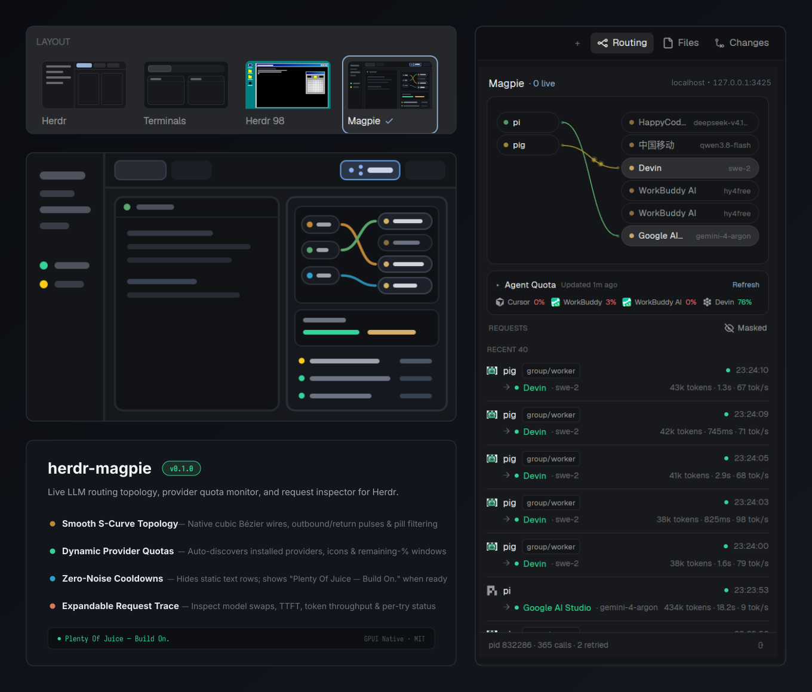

<div align="center">


# herdr-magpie

**面向 [Herdr](https://herdr.dev) 的 Magpie 实时路由拓扑、供应商配额监控与请求追踪面板。**

[](https://github.com/dorokuma/herdr-magpie/releases)
[](https://herdr.dev)
[](https://gpui-kit.com)
[](LICENSE)

[English](README.md) · 简体中文

</div>

---

<div align="center">
  
</div>

## 核心特性

- **平滑 S 型贝塞尔拓扑连线** — 基于 GPUI 原生 `PathBuilder.cubic_bezier_to` 绘制三次贝塞尔实线，具备 `4px` 端口微距留白与锚点、原生 `.loop()` 呼吸发光、与真实请求同步的去程/返程脉冲光点，以及报错重试时的红闪抖动提示。
- **胶囊联动高亮与过滤** — 悬停任意 Agent 或右侧账号胶囊即可高亮其活跃与近期路由连线；点击胶囊可锁定高亮并联动过滤下方 `REQUESTS` 列表。
- **动态供应商配额监控** — 自动读取用户本机或远端 `~/.config/magpie/providers.json` 与路由元数据，内置 85+ 常见 Agent 与模型供应商彩色/单色图标。统一采用 **剩余百分比（Remaining %）** 与首字母大写（Title Case）规范，额度耗尽时醒目显示红色 `Exhausted`；自动隐藏无意义的静态说明文本，并在零冷却时常驻显示 `● Plenty Of Juice — Build On.`。
- **可展开的请求追踪明细** — 区分 `IN FLIGHT` 与 `RECENT` 实时流，支持一键切换 `Masked` / `Shown` 隐私脱敏；点击任意请求行即可就地展开查看请求/实际模型切换、TTFT 首字延迟、输入/输出 Token 与历次 `tries` 状态码。
- **原生设置页布局卡片** — 在 Herdr **Settings → Look → Layout** 中提供名为 **Magpie** 的专属布局与高清微缩预览图。

## 快速安装

```bash
git clone https://github.com/dorokuma/herdr-magpie.git
cd herdr-magpie
chmod +x install.sh
./install.sh
```

安装完成后，在 Herdr 中按 `Ctrl+Shift+L`（或在 **Settings → Look → Layout** 中选择 **Magpie**），再点击右上角标签栏的 **Routing** 按钮即可展开面板。

## 远端网关配置（可选）

默认连接本机 `http://127.0.0.1:3425`。如果你的 Magpie 运行在通过 `herdr-core` 连接的远端机器上，可复制示例配置：

```bash
cp ~/.config/herdr-app/mods/routing/config.example.json \
   ~/.config/herdr-app/mods/routing/config.json
```

修改 `~/.config/herdr-app/mods/routing/config.json`：

```json
{
  "remote": "my-remote-machine",
  "label": "my-remote-machine · 127.0.0.1:3425",
  "baseUrl": "http://127.0.0.1:3425"
}
```

## 开源协议

基于 [MIT License](LICENSE) 开源。
