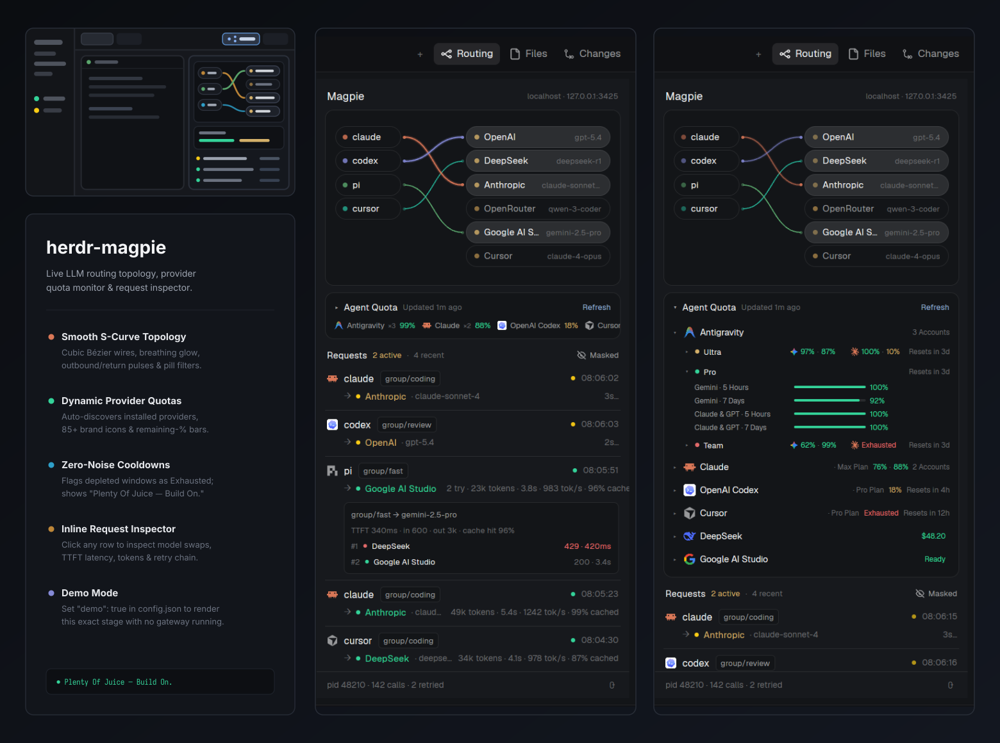

# Magpie

A Herdr workspace layout and side-panel mod that visualizes Magpie's live LLM routing topology, provider quota windows, and per-request traces beside your active terminals.

## What you see

- **Left sidebar (`268px`, `chrome`)**: Herdr's shipped `workspace-chrome`, `spaces`, and `agents` panels.
- **Top tab bar (`42px`, `chrome`)**: `tabs-routing`, which adds a **Routing** toggle pill with a custom node-split icon (`mods/routing/route.svg`) beside `Files` and `Changes`.
- **Center workspace (`flex_1`, `background`)**: The active tab's terminals wrapped in `10px` rounded pane cards (`pane` header, `30px`).
- **Right Routing panel (`368px`, `surface`)**:
  - **Header**: `Magpie` on the left, followed by an `↑ Update x.y.z` pill only when a newer release exists, and the gateway label (`localhost · 127.0.0.1:3425` or a configured remote host) on the right.
  - **Topology stage (`canvas` card)**: Agent pills on the left (`72–88px`) and provider/account pills on the right (`156–240px`), linked by smooth cubic Bézier S-curves with `4px` port spacing, `3.5px` anchor dots, breathing glow on active routes, and traveling light pulses.
  - **Agent Quota (`canvas` card)**: Collapsible provider allowance monitor listing every account each provider reports, not one per provider. When collapsed, shows a 4-provider summary strip with brand icons, remaining percentages and `×N` for a multi-account provider; when expanded (`max_h: 360px` with `Scrollbar.vertical("quota-body")`), shows Title-Case remaining-% bars (`#34d399` >= 30%, `#d4b06a` < 30%, `#e26a6a` < 10% or `Exhausted`) and `● Plenty Of Juice — Build On.` when a plugin provider has zero active cooldowns. Providers and their accounts fold on a click and reorder on a drag, both remembered in browser storage; a folded row keeps its balance or its remaining share and `Resets in …`. The share is read short window first, long window after (`71% · 96%`), each in its own colour; it is `Exhausted` once the long window is empty, and a provider with several pools shows the tightest pool in each column. Accounts of one provider show the same rows, so a credits breakdown or a paired `5 hours` / `7 days` window is not missing where another account has it.
  - **Requests feed**: One `Requests` header carrying the counts (`2 active · 40 recent`), an active filter chip and the `Masked` / `Shown` privacy toggle, followed by one scrollable list with active requests first (`#facc15` active, `#34d399` answered, `#e26a6a` failed). An answered row ends with its cache hit rate (`· 99% cached`), and its expanded card lists `cache hit 99%` beside TTFT and the token counts.
  - **Footer**: Gateway `pid`, total calls, retried count, and a clickable `⟳` refresh button.

## How it behaves

- **Live S-curve flights**: When `/v1/magpie/trace` reports a new try on an upstream account, an outbound pulse glides along the cubic Bézier curve (`out`), holds at the account while generating (`held` / `waitDone`), shakes and flashes `#e26a6a` on retry (`retry`), and glides back to the agent when `r.done` completes (`back`).
- **Hover and click-to-filter**: Hovering any agent or account pill highlights its active and recent wires (`stroke: 2px`) while dimming unrelated wires (`0.16` opacity). Clicking a pill locks the selection and filters the `Requests` list below.
- **Expandable request trace**: Clicking any request row expands an inset card showing requested-vs-served model swaps, TTFT, input/output token counts, and every try's account, HTTP status, and duration.
- **Dynamic provider discovery**: Reads `~/.config/magpie/providers.json` and `/v1/magpie/trace` order metadata to resolve each user's installed providers and icons automatically.
- **Fold, reorder, remember**: A provider's title and an account's row both fold on a click and reorder on a drag; the order and the fold state live in browser storage, so a quota refresh or a restart keeps them. Dragging above the first row lands on it and draws its drop line inside the scroll area.
- **Offline demo mode**: Setting `"demo": true` in `mods/routing/config.json` loads the fully synthetic `mods/routing/demo.json` fixture, skips all gateway polling, and renders a deterministic review/screenshot stage with invented agents, providers, requests, and quotas.

## Built from

- **Layout**: `layouts/Magpie.json` (`preview`: `layouts/Magpie.png` & `layouts/Magpie.svg`), stacking `files`, `changes`, and `routing` inside `panel-body`.
- **Mods**:
  - `mods/routing/main.js` — `View` using `PathBuilder.stroke().cubic_bezier_to()`, `window.paint_path()`, `Scrollbar.vertical("quota-body")`, `.loop("opacity", ...)`, `exec("curl", ...)`, and `readTextFile()`.
  - `mods/tabs-routing/main.js` — Tab bar mod remembering the open side panel per space in `localStorage` and toggling `panel` / `panel-body`.

## Watch out

- **Scroll preservation**: `quota-body` uses `overflow_y_scroll()` paired with `Scrollbar.vertical("quota-body")` inside a `relative().max_h(360)` wrapper instead of `overflow_y_scrollbar()`, because `overflow_y_scrollbar()` wraps the element and breaks `max_h`. Both `quota-body` and `requests-list` carry stable `.id()`s so 40ms flight frames never reset scroll position.
- **Color vs. monochrome icons**: Monochrome icons use `svg().text_color()`, whereas multi-color brand icons are pre-rendered to `64×64` PNGs and drawn via `image()` so GPUI preserves their gradients.
- **Network**: Polls `http://127.0.0.1:3425/v1/magpie/trace` and `/v1/magpie/quotas` locally by default, or on a remote Herdr core machine when configured in `mods/routing/config.json`. In demo mode, no network requests are made.

## Done when

- `herdr-app check mods/routing` and `herdr-app check mods/tabs-routing` both pass.
- Switching to `Magpie` (`herdr-app do layout.switch '{"name":"Magpie"}'`) shows the `Magpie` layout card and thumbnail in Settings → Look.
- Clicking **Routing** in the tab bar opens the Magpie panel, renders smooth S-curves without dashed corner artifacts, scrolls `Agent Quota` without snapping back to the top, and expands request details inline without horizontal overflow.
- Setting `"demo": true` in `mods/routing/config.json` renders the same interface from `mods/routing/demo.json` without contacting a gateway or exposing live provider data.
